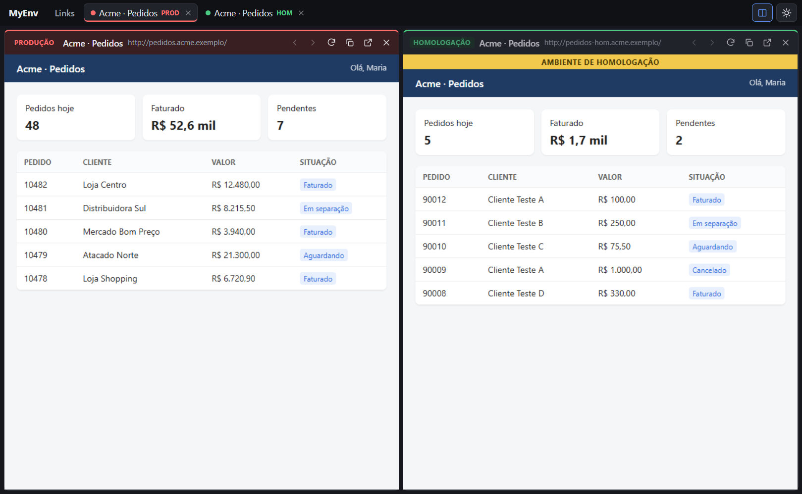
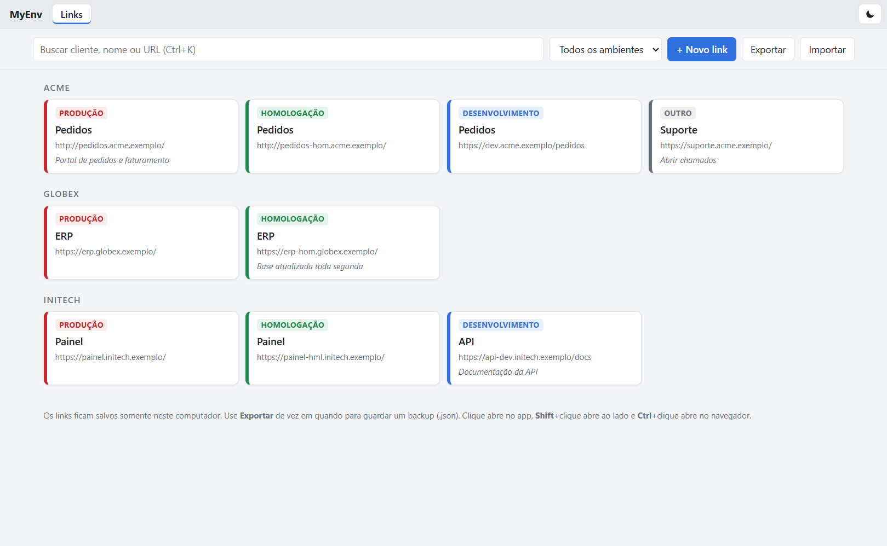

# MyEnv

**Os ambientes de cada cliente em um só lugar.**

Quem atende vários clientes vive procurando a URL certa: produção, homologação, desenvolvimento, o portal de um, o painel de outro. O MyEnv reúne esses links por cliente, pinta cada ambiente com uma cor e deixa tudo a um `Ctrl+K` de distância. Assim fica mais difícil abrir produção quando a intenção era homologação.



<details>
<summary>Lista de links por cliente</summary>



</details>

> As imagens usam clientes e páginas fictícios.

## Funcionalidades

- **Ambientes dentro do app**: o link abre numa aba do próprio MyEnv, com a cor do ambiente na aba e no topo da página.
- **Lado a lado**: divida a tela em duas e compare produção com homologação ao mesmo tempo.
- **Sessões separadas**: cada link guarda o próprio login, então dá para ficar logado em produção e em homologação ao mesmo tempo.
- **Links por cliente**: cada link tem cliente, nome, URL, ambiente e observação.
- **Cores por ambiente**: produção em vermelho, homologação em verde, desenvolvimento em azul.
- **Busca rápida**: `Ctrl+K` leva à busca, que ignora acentos e aceita várias palavras (`acme hom`). `Enter` abre o primeiro resultado.
- **Filtro por ambiente**: mostra só produção, só homologação etc.
- **Tema claro e escuro**: alterne pelo botão de sol/lua. A escolha fica salva; sem escolha, o app segue o tema do sistema.
- **Backup**: exporte e importe todos os links em um arquivo `.json`.
- **Privacidade**: os dados ficam só no computador, sem conta, sem servidor e sem nada enviado para a internet.

## Instalação

Baixe a versão mais recente na página de [Releases](../../releases):

| Arquivo | Uso |
|---|---|
| `MyEnv-<versão>.exe` | Portátil: é só executar, sem instalar. |
| `MyEnv-Setup-<versão>.exe` | Instalador com atalho no menu Iniciar. |

> O executável ainda não tem assinatura digital, então o Windows SmartScreen pode mostrar um aviso na primeira execução. Para seguir, clique em **Mais informações → Executar assim mesmo**.

## Uso

| Ação | Como |
|---|---|
| Abrir no app | Clique no cartão ou `Enter` na busca |
| Abrir ao lado | Botão de tela dividida no cartão, `Shift`+clique ou `Shift+Enter` |
| Abrir no navegador | Botão de seta no cartão ou no painel, `Ctrl`+clique ou `Ctrl+Enter` |
| Dividir / juntar a tela | Botão de tela dividida na barra de abas |
| Voltar para a lista | Aba **Links** ou `Ctrl+K` |
| Trocar de aba | `Ctrl+Tab` / `Ctrl+Shift+Tab` |
| Fechar a aba | `×` na aba, clique do meio ou `Ctrl+W` |
| Voltar, avançar, recarregar | Botões do painel, `Alt+←`, `Alt+→` e `F5` |

Com a tela dividida, o lado vazio mostra uma lista para escolher o que abrir. Os links do mesmo cliente aparecem primeiro.

Algumas coisas continuam funcionando só no navegador: senhas salvas, extensões e sites com certificado inválido. Por segurança, o MyEnv não abre páginas com certificado inválido; nesses casos use **Abrir no navegador**.

## Onde ficam os dados

Os links ficam no armazenamento local do aplicativo, em `%APPDATA%\MyEnv`. Os logins feitos dentro do app ficam na mesma pasta, separados por link, e são apagados quando o link é excluído. O executável e a versão aberta no navegador guardam listas separadas. Para levar os links de um para o outro, use **Exportar** e **Importar**.

Na primeira execução, o MyEnv copia sozinho os links do antigo Painel de Links (`%APPDATA%\Painel de Links`), se eles existirem.

### Formato do backup

```json
{
  "formato": "myenv-backup",
  "versao": 1,
  "geradoEm": "2026-11-18T12:00:00.000Z",
  "links": [
    {
      "id": "lz8k2a1b3c",
      "cliente": "Acme",
      "nome": "Portal",
      "url": "https://portal.acme.com.br/",
      "ambiente": "producao",
      "obs": ""
    }
  ]
}
```

`ambiente` aceita `producao`, `homologacao`, `desenvolvimento` ou `outro`. A importação também aceita a lista simples de links das versões antigas.

## Desenvolvimento

Requer [Node.js](https://nodejs.org/) 18 ou superior.

```bash
npm install
npm start
```

Também dá para abrir `src/index.html` direto no navegador, sem Electron.

> Se o `npm start` rodar no terminal do VS Code e a janela não abrir, é porque o VS Code define `ELECTRON_RUN_AS_NODE=1`. Rode `Remove-Item Env:ELECTRON_RUN_AS_NODE` (PowerShell) antes ou use outro terminal.

### Gerar os executáveis

```bash
npm run dist              # dist/MyEnv-<versão>.exe (portátil)
npm run dist:instalador   # dist/MyEnv-Setup-<versão>.exe (instalador)
```

A versão vem do campo `version` do `package.json`. Para redesenhar o ícone, edite `scripts/gerar-icone.js` e rode `npm run icone`.

### Estrutura

```
electron/
  main.js              processo principal: janela, canais de comunicação e migração de dados
  paineis.js           páginas embutidas: sessões, permissões, navegação e erros
  preload.js           ponte segura entre a tela e o processo principal
src/
  index.html           tela
  css/estilo.css       estilo e paletas dos temas claro e escuro
  js/armazenamento.js  leitura e gravação dos links e do tema
  js/tema.js           alternância de tema
  js/comum.js          ambientes, ícones e funções de texto compartilhadas
  js/espaco-trabalho.js abas, divisão da tela e painéis
  js/app.js            cadastro, busca, filtro, exportar e importar
build/
  icon.png             ícone do aplicativo
scripts/
  gerar-icone.js       gera o build/icon.png
```

### Arquitetura

A tela (`app.js`) nunca acessa o `localStorage` diretamente. Tudo passa pelo módulo `Armazenamento`, que já tem uma interface assíncrona (`carregarLinks`, `salvarLinks`). Na versão web, basta trocar a implementação desse módulo por chamadas a uma API, sem mexer na tela.

### Segurança

- A tela do app e as páginas dos clientes rodam em processos separados, com `sandbox`, `contextIsolation` e sem `nodeIntegration`. As páginas embutidas não têm acesso ao computador nem ao MyEnv.
- A tela só fala com o processo principal por uma ponte (`preload.js`) com poucas funções. O processo principal valida cada mensagem e só aceita as que vêm da janela principal.
- Cada link usa uma sessão própria (`persist:link-<id>`), isolando cookies e logins entre ambientes.
- Pedidos de permissão (câmera, microfone, localização, notificações) são negados.
- Só endereços `http` e `https` abrem nas abas, e certificados inválidos são recusados.
- A tela do app tem uma Content Security Policy que só permite recursos locais.

## Roadmap

- [x] App de desktop com dados locais
- [x] Tema claro e escuro
- [x] Abas e tela dividida
- [ ] Ajustar a largura dos lados arrastando a divisória
- [ ] Reabrir as abas da última sessão
- [ ] Assinatura digital do executável
- [ ] Versão web com conta de usuário e sincronização entre dispositivos

## Changelog

Veja o [CHANGELOG.md](CHANGELOG.md).

## Licença

Copyright (c) 2026 Cristovao Melchioretto. Todos os direitos reservados.

O código está publicado para consulta, e os executáveis da página de [Releases](../../releases) podem ser baixados e usados livremente. Reutilizar o código exige autorização do autor. Veja o arquivo [LICENSE](LICENSE).
